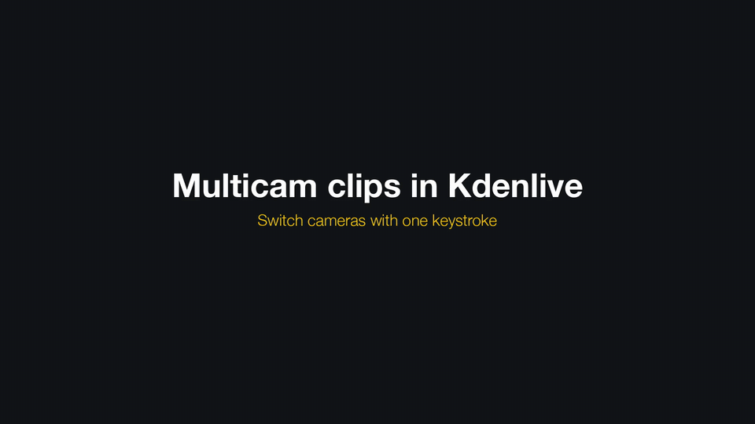

> [!NOTE]
> **This is an experimental fork of Kdenlive that adds multicam clips.** The feature lives on the `multicam-clips` branch. It is not part of Kdenlive and has not been submitted to KDE. It was developed with the help of an AI coding assistant and has been tested on macOS only. Bug reports are welcome as [issues](https://github.com/stoeppke/kdenlive/issues).

## Multicam clips

[Watch the demo as video with sound (58 s)](.github/multicam-demo.mp4)

Multicam clips work like in Final Cut Pro: several synchronized cameras become one clip in the timeline, and you cut between camera angles inside that clip. Every piece is a cut of the same sequence, so the cameras cannot drift apart.

- **Create:** put the synchronized camera clips on separate video tracks, select them with their audio and choose *Sequence › Multicam › Create Multicam Clip from Selection*. The clips move into a new sequence with one angle per video track, named after the tracks, and a single multicam clip replaces them, showing angle 1.
- **Cut to an angle:** *Cut to Angle 1…9* (<kbd>Cmd</kbd>+<kbd>Option</kbd>+<kbd>1…9</kbd> on macOS, <kbd>Ctrl</kbd>+<kbd>Alt</kbd>+<kbd>1…9</kbd> on Linux and Windows) cuts the multicam clip at the playhead and shows that angle from there on. It works during playback too.
- **Switch without cutting:** *Sequence › Multicam › Switch Angle* or the clip's context menu *Multicam Angle* changes the angle of the selected pieces. *Full Sequence* shows the sequence as usual.
- **Any sequence works:** each video track of a sequence is an angle, counted from the bottom. The audio of a multicam clip is the sequence's mix.

Known limitations:

- Switching angles during playback pauses the picture for about a second, while Kdenlive seeks in the other camera's file. Proxy clips make this shorter.
- There is no angle viewer showing all cameras side by side yet, and Kdenlive has no roll edit to move a switch point.
- Speed changes and time remapping are not available on multicam clips.

To try it, build the `multicam-clips` branch as described in [dev-docs/build.md](dev-docs/build.md).

---

# Kdenlive

Kdenlive is a powerful, free and open-source video editor that brings professional-grade video editing capabilities to everyone. Whether you're creating a simple family video or working on a complex project, Kdenlive provides the tools you need to bring your vision to life.

For more information about Kdenlive's features, tutorials, and community, please visit our [official website](https://kdenlive.org).

There you can also find downloads for both stable releases and experimental daily builds for Kdenlive.

## Contributing to Kdenlive

Kdenlive is a community-driven project, and we welcome contributions from everyone! There are many ways to contribute beyond coding:

- Help translate Kdenlive into your language
- Report and triage bugs
- Write documentation
- Create tutorials
- Help other users on forums and bug trackers

Visit [kdenlive.org](https://kdenlive.org) to learn more about non-code contributions.

## Developer Information

### Technology Stack

Kdenlive is written in C++ and is using these technologies and frameworks:

- **Core Framework**: MLT for video editing functionality
- **GUI Framework**: Qt and KDE Frameworks 6
- **Additional Libraries**: frei0r (video effects), LADSPA (audio effects)

### Getting Started

1. Check out our [build instructions](dev-docs/build.md) to set up your development environment
2. Familiarize yourself with the [architecture](dev-docs/architecture.md) and [coding guidelines](dev-docs/coding.md)
4. If the MLT library is new to you check out [MLT Introduction](dev-docs/mlt-intro.md)
3. Join our Matrix channel `#kdenlive-dev:kde.org` for developer discussions and support

### Contributing Code

Kdenlive's primary development happens on [KDE Invent](https://invent.kde.org/multimedia/kdenlive). While we maintain a GitHub mirror, all code contributions should be submitted through KDE's GitLab instance. For more information about KDE's development infrastructure, visit the [KDE GitLab documentation](https://community.kde.org/Infrastructure/GitLab).

### Finding Things to Work On

- Browse open issues on [KDE Invent](https://invent.kde.org/multimedia/kdenlive/-/issues), for example those labeled with [First Task](https://invent.kde.org/multimedia/kdenlive/-/issues?label_name%5B%5D=First%20Task)
- Check the [KDE Bug Tracker](https://bugs.kde.org) for reported issues
- Look for issues tagged with "good first issue" or "help wanted"

Need help getting started? Join our Matrix channel `#kdenlive-dev:kde.org` - our community is friendly and always ready to help new contributors!

Please get in touch with us before working on a task, either by commenting in the issue or through our Matrix channel.
